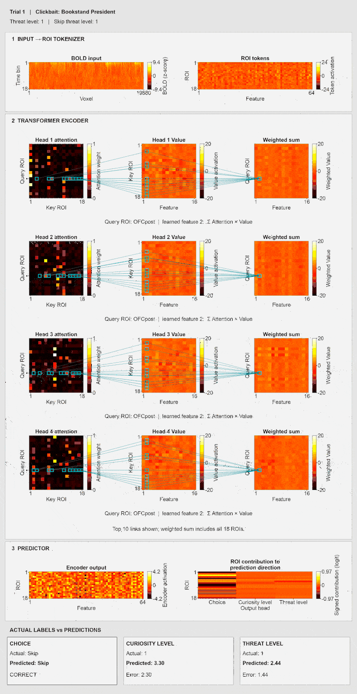

# Curiosity transformer model and Figure 5 code



This is a standalone source-code package for the curiosity project. It contains the model and Figure 5 scripts, with model classes and function definitions centralized in `utility_transformer.py`. The analysis scripts retain their parameters, data-loading loops, statistical comparisons, plotting calls and output steps. It does not require the original `Dean_Code_c` repository or `utility_functions.py`.

## Contents

| File | Purpose |
| --- | --- |
| `analysis_transformer_train.py` | Input loading, voxel caching, and leave-one-participant-out training |
| `utility_transformer.py` | All model classes and functions, grouped under training, activity-map, attention and behavior entry points |
| `fig5_transformer_beh.py` | Observed and predicted choices and model performance |
| `fig5_attention.py` | Attention, intervention, connectivity, and value-message analyses and plots |
| `fig5_activitymap.py` | ROI contribution effects and brain maps |
| `assets/` | AAL3 atlas, labels, SVC mask, and the ROI manifest required by the model |
| `transformer_architecture.gif` | Existing architecture animation displayed above |

The four assets are model inputs, not optional reports. Keep them together. Atlas redistribution and attribution should follow the original atlas provider's terms; this package does not assign a new license to third-party assets.

## Installation

Use Python 3.12 or newer (the scripts use Python 3.12 f-string syntax).

```bash
python -m venv .venv
source .venv/bin/activate
python -m pip install -r requirements.txt
```

The requirements pin the direct dependency versions installed in the author’s local Python 3.12 environment when this package was prepared. They are not a record of the historical training environment and do not lock all transitive dependencies. CPU training is supported; a compatible PyTorch installation is needed for GPU training. Arial is used for figures; substitute an installed font if necessary.

## Data and trained models

Raw participant data, voxel caches, trained weights, and analysis results are deliberately excluded to keep this repository small. The figures cannot be reproduced from source code and atlas assets alone. No external data-download link is supplied in this package.

By default, put these input directories inside this folder:

- `bold_signals_standard/`: `standard_bold_par01_s3.nii.gz` through `standard_bold_par30_s3.nii.gz`, with the timing information used by the original analysis.
- `beh_fmri/`: the original tab-separated behavior and timing files, including `output_formal_fix_parXX.txt`, `output_formal_{FLevel,CLevel,clickbaitLabel,clickbaitRes,ori1,ori2,oriSpace}_parXX.txt`, self/risk ratings, and `output_parXX_mousePos/trial_XX.txt`.

The loader defines the expected columns and zero-based mouse-trial numbering. Do not substitute differently formatted data without checking the loader.

Alternatively, set `BOLD_TS_ROOT` and `BEH_DIR` to existing input directories. `SMALLVOLUME_CACHE_DIR` can override the voxel-cache location. The original analysis uses 30 participants and 128 task trials per participant.

Training creates `cache_voxels/` and `results_arch/`. Figure scripts expect the selected architecture's results under `results_arch/d64_l1_h4/seed42/`, including `models/loso_parXX.pt` and `per_subject/` predictions and summaries. Supply these results separately or regenerate them. The trajectory script also reads the matching ROI and participant voxel caches; keep those in `cache_voxels/` for that script.

## Training

Run commands from this folder. For the Figure 5 architecture (64 model dimensions, one layer, four heads, feed-forward dimension 128, seed 42):

```bash
export MODEL_ARCH=d64_l1_h4
export TRAIN_SEED=42
python analysis_transformer_train.py --verify-inputs
python analysis_transformer_train.py --all --device cpu --epochs 80 \
  --d-model 64 --num-layers 1 --nhead 4 --dim-ff 128 \
  --lambda-group 0 --inter-rank 0
```

The training defaults are d_model=64, num_layers=1, nhead=4, dim_ff=128, dropout=0.2, seed=42, T_BOLD=18, T_TRAJ=50, and all SVC voxels (no PCA). Optimization uses AdamW with learning rate 0.0003, weight decay 0.02, batch size 16, up to 80 epochs, patience 15, lambda_group=0, and lambda_l1=0.001.

Use `--held-out par01` instead of `--all` to train one fold. Run `python analysis_transformer_train.py --help` for other options. Training is computationally expensive; no pretrained weights are included.

## Figure scripts

After preparing the required data and results:

```bash
python fig5_transformer_beh.py
python fig5_attention.py
python fig5_activitymap.py
```


## Statistical interpretation

Model calculations and figure analysis settings are preserved from the source scripts. In particular, `fig5_activitymap.py` currently uses an **exploratory sign-flip percentile threshold**, taking the within-permutation 95th percentile of absolute t statistics. This is **not max-|t| family-wise error correction**. Unthresholded t maps and positive-effect masks serve different purposes; consult the script before interpreting them as confirmatory results.

## Repository size and checks

This package is approximately 31 MiB, mainly the existing architecture GIF (about 29 MiB). No training outputs, raw data, or model weights are included. `.gitignore` excludes the standard data, cache, and training-result directories.

Packaging checks cover Python syntax, standalone model import, model-definition equivalence, and local helper dependencies. Full training and figure regeneration have not been rerun as part of packaging.

## PyCharm Console and working directory

When running a selection in PyCharm Console, `__file__` is absent. Set the console working directory to this package or its parent. All five scripts now resolve either location. From any other location, run the script as a file or change the working directory first. The lightweight package still requires the data and trained results described above; locating the script is not the same as supplying those inputs.

## Bash training entry point

Activate your Python environment first, then run from the package folder:

```bash
bash configure_and_run_me_first.sh --help
# Read and check inputs without training:
CHECK_ONLY=1 bash configure_and_run_me_first.sh local
# Train the 30 LOSO folds for d64_l1_h4, seed 42:
bash configure_and_run_me_first.sh local
```

Set `PYTHON_BIN` to the absolute path of your environment's Python if needed. Set `BOLD_TS_ROOT` and `BEH_DIR` when inputs are stored elsewhere. `DEVICE=cuda` selects GPU training; the default is CPU. `EPOCHS` defaults to 80. The Bash and Python entry points use the same Figure 5 configuration; no architecture or seed grid is run.

For a Slurm cluster, configure the cluster-specific options rather than using the original lab's account:

```bash
SLURM_ACCOUNT=your_account SLURM_PARTITION=your_partition bash configure_and_run_me_first.sh submit
```

Submission mode creates cache jobs and schedules training only after they succeed. Slurm log files are written under `logs/`. No jobs are submitted by `--help` or `CHECK_ONLY=1`.

## Using existing activity-map inputs

`fig5_activitymap.py` accepts `TRANSFORMER_DATA_DIR` pointing to a folder containing `results_arch/` and `cache_voxels/`. Without this variable, it uses this package first, or the existing sibling `analysis_transformer_model_and_assets` folder when this package has no results directory. Model source and atlas assets remain in this package; outputs remain at the script’s configured output location. No weights are copied or downloaded automatically.

## Figure display

The figure scripts display plots with `plt.show()` and do not automatically save PNG or GIF figures. Use an interactive Matplotlib backend in PyCharm or your Python session. `fig5_activitymap.py` continues to write its numerical NIfTI t maps and masks under `results_2ndlevel_arch/`; it is not a 2D plotting script. The architecture GIF included above is an existing illustration.

`CACHE_PREFIX` identifies the existing voxel-cache format and is used in cache filenames and hashes. Its value is retained for compatibility with the original trained results.


## Code organization

The four analysis scripts retain their original top-level workflow. Only function and class definitions are in `utility_transformer.py`; no `run_*` wrapper hides an entire script. Functions that depend on script settings receive an explicit `context` argument. This keeps each script's parameters and mutable caches separate while preserving the visible sequence of analysis steps.

## Local imports

Scripts import directly from `utility_transformer.py` in this folder. Run them as files, or set the PyCharm Python Console working directory to `analysis_transformer_model_curiosity_project` before executing selected code. Parent-directory import fallbacks are not used.
